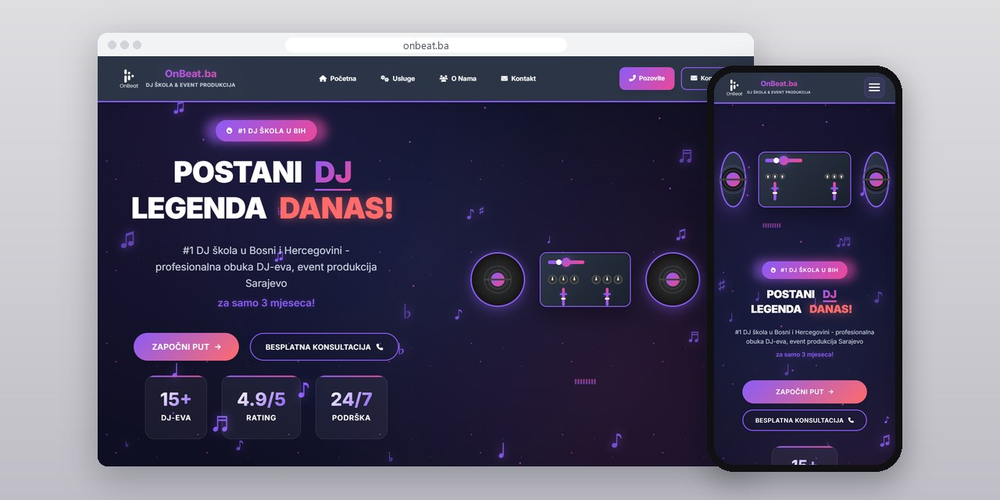
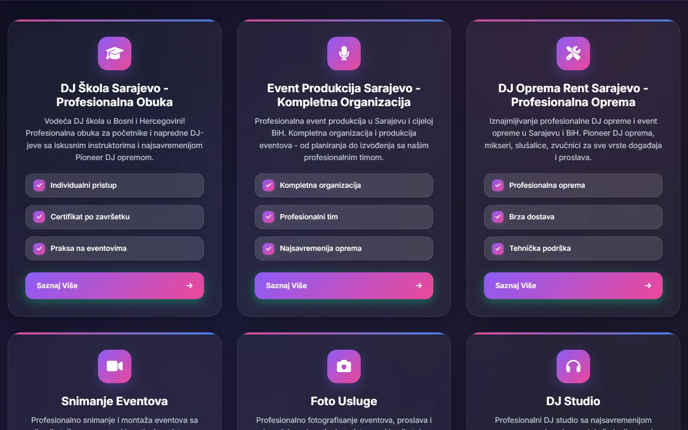

# OnBeat.ba

One-page site for a Sarajevo DJ school that also produces events, with a DJ deck drawn in CSS and a form that asks which service you need.

**[onbeat.ba](https://onbeat.ba/)** · [Case study (in Serbian)](https://svilenkovic.rs/radovi/onbeat-ba) · [Srpski](README.sr.md)

> [!NOTE]
> Client project, hosted by the client. The source code belongs to the client and is not published. This page describes what I built and how.

<table>
  <tr><td><b>Client</b></td><td>OnBeat.ba</td></tr>
  <tr><td><b>Industry</b></td><td>DJ school and event production</td></tr>
  <tr><td><b>Location</b></td><td>Sarajevo, Bosnia and Herzegovina</td></tr>
  <tr><td><b>Type</b></td><td>One-page website</td></tr>
  <tr><td><b>My role</b></td><td>Design and development</td></tr>
  <tr><td><b>Stack</b></td><td>PHP, HTML, CSS, JavaScript</td></tr>
</table>

## About the project

OnBeat.ba runs a DJ school in Sarajevo and also produces events, rents out DJ equipment, films and photographs celebrations and has a DJ studio. All six services are short to explain, so the site fits on one page that follows the order in which a visitor decides: what they do, a few words about the school, then the contact.

The opening section has two turntables and a mixer with knobs and faders, a sound visualiser and floating notes, all built from HTML and CSS rather than photos, so the deck stays sharp on any screen and adds no images to the first load. The contact form asks which service the inquiry is about, checks each field as the visitor leaves it and sends the message in the background, so inquiries arrive already sorted.

## What I built

- One page in four parts: opening, six services, about the school and contact
- A DJ deck with turntables, mixer and visualiser drawn in HTML and CSS and animated with JavaScript
- Service cards with a short description, three points each and a button that leads to the form
- A contact form with a service drop-down, field checks and sending in the background without a page reload
- Direct links for a call, Viber, WhatsApp and email, plus Facebook and Instagram
- Structured data for the organisation, the school and the website

## Screenshots

<table>
  <tr>
    <td width="68%" valign="top"></td>
    <td width="32%" valign="top"></td>
  </tr>
</table>

Service cards, each with three points and a button that leads to the form

Contact details and a form with a service choice

---

Built by [D. Svilenković](https://svilenkovic.com).
